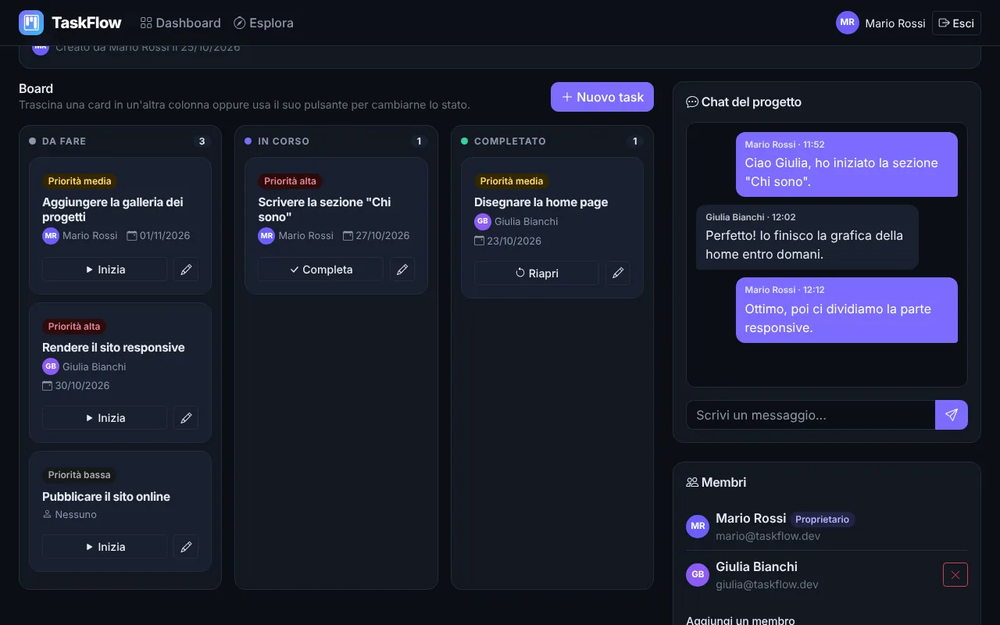
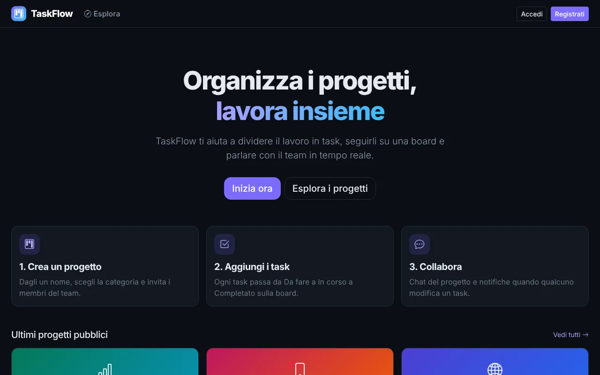
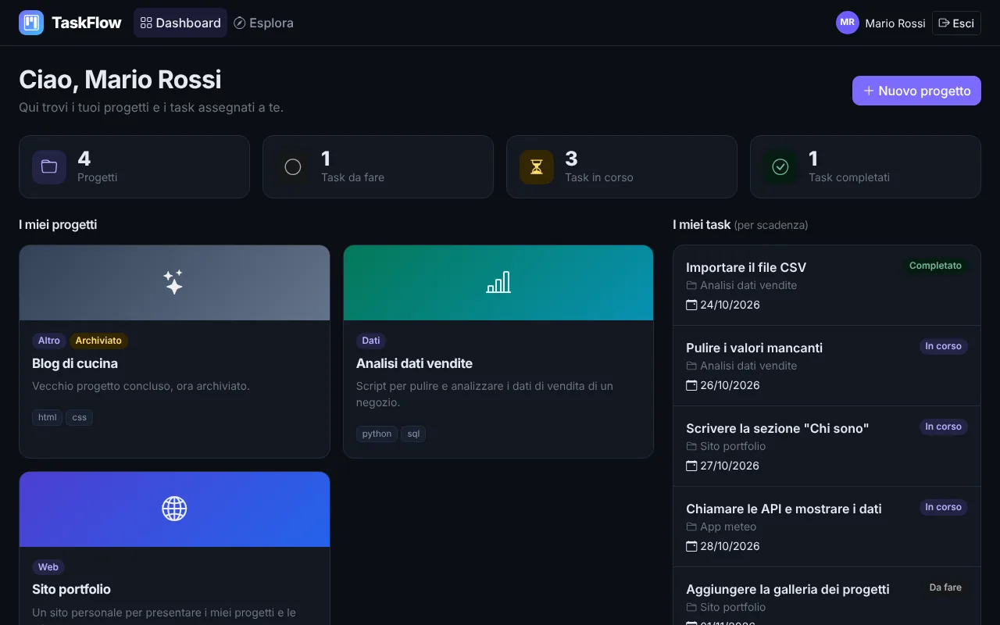

# TaskFlow

Progetto d'esame del corso Node.js (ITS Academy ICT Piemonte): una piattaforma collaborativa per gestire progetti e task, con board Kanban, chat di progetto e aggiornamenti in tempo reale.



## Cos'è TaskFlow

Ogni utente può registrarsi, creare progetti, invitare altre persone e organizzare il lavoro in task. I task si vedono su una board con tre colonne (**Da fare**, **In corso**, **Completato**). Chi lavora sullo stesso progetto parla in una chat e riceve una notifica quando qualcun altro cambia un task. I progetti pubblici si possono scoprire dalla pagina "Esplora".

I dati nelle immagini sono quelli demo creati da `npm run seed`.

## Come è stato sviluppato

Il codice è stato scritto con l'aiuto di un assistente AI. Lo uso per studiare Node.js, Express e MongoDB: la guida [docs/STUDY_GUIDE.md](docs/STUDY_GUIDE.md) spiega come funziona ogni parte (JWT, middleware, Mongoose, Socket.IO) e indica i file da leggere.

## Funzionalità

- Registrazione, login e logout con token JWT; password cifrate con bcrypt
- Ruoli `user` e `admin`
- Creazione, modifica, archiviazione ed eliminazione dei progetti (solo il proprietario)
- Gestione dei membri: il proprietario aggiunge e rimuove, chiunque può entrare in un progetto pubblico
- Task con titolo, descrizione, assegnatario, scadenza e priorità
- Board Kanban a tre colonne: lo stato si cambia con il pulsante della card (Inizia / Completa / Riapri), trascinando la card oppure dalla finestra del task
- Dashboard personale con card riepilogative, progetti creati, progetti a cui si partecipa e task ordinati per scadenza
- Pagina "Esplora progetti" con filtri per categoria e tecnologia e ordinamento per data
- Chat realtime per ogni progetto (solo membri) con Socket.IO
- Notifiche (toast) quando un task viene creato, modificato, spostato, assegnato o eliminato
- Pannello admin: elenco utenti con blocco/sblocco, elenco progetti con archiviazione
- Interfaccia con tema scuro (dark mode di Bootstrap 5.3) e responsive
- Gestione centralizzata degli errori e risposte JSON sempre nello stesso formato

## Tecnologie

| Parte | Strumenti |
| --- | --- |
| Backend | Node.js, Express, MongoDB, Mongoose |
| Sicurezza | jsonwebtoken (JWT), bcrypt, cors |
| Realtime | Socket.IO |
| Configurazione | dotenv |
| Frontend | HTML, CSS, JavaScript semplice, Bootstrap 5.3 (tema scuro), Bootstrap Icons |

## Installazione

Servono Node.js 20.19 o superiore e un MongoDB raggiungibile (locale oppure MongoDB Atlas).

```bash
npm install
cp .env.example .env
```

Su Windows, nel Prompt dei comandi (cmd) usa `copy .env.example .env`; in PowerShell `cp` funziona come sopra.

Poi apri `.env` e controlla i valori (vedi la sezione successiva).

## Configurazione

Il file `.env` contiene:

| Variabile | Significato | Esempio |
| --- | --- | --- |
| `PORT` | porta del server | `3000` |
| `MONGODB_URI` | indirizzo del database | `mongodb://127.0.0.1:27017/taskflow` |
| `JWT_SECRET` | stringa segreta per firmare i token | una frase lunga a tua scelta |

Il file `.env` non va mai caricato su Git (è già nel `.gitignore`).

## Avvio

```bash
npm run seed   # facoltativo: inserisce i dati demo (cancella il database!)
npm run dev    # avvio con riavvio automatico (nodemon)
```

In alternativa `npm start` avvia il server senza riavvio automatico. Poi apri http://localhost:3000.

## Struttura delle cartelle

```
taskflow-nodejs/
├── server.js                    avvio: Express, Socket.IO, route e connessione al database
├── package.json
├── .env.example                 esempio di configurazione (il vero .env non è su Git)
├── src/
│   ├── config/
│   │   └── db.js                connessione a MongoDB
│   ├── models/                  schemi Mongoose
│   │   ├── User.js
│   │   ├── Project.js
│   │   ├── Task.js
│   │   └── Message.js
│   ├── routes/                  quali URL esistono e quali middleware usano
│   │   ├── authRoutes.js        /api/auth
│   │   ├── userRoutes.js        /api/users
│   │   ├── projectRoutes.js     /api/projects
│   │   ├── taskRoutes.js        /api/projects/:id/tasks
│   │   └── adminRoutes.js       /api/admin
│   ├── controllers/             la logica di ogni endpoint
│   │   ├── authController.js
│   │   ├── userController.js
│   │   ├── projectController.js
│   │   ├── taskController.js
│   │   ├── messageController.js
│   │   └── adminController.js
│   ├── middleware/
│   │   ├── authMiddleware.js    login (protect) e ruolo admin (adminOnly)
│   │   ├── projectMiddleware.js progetto dalla URL e permessi (membro, proprietario)
│   │   └── errorMiddleware.js   404 e gestione centralizzata degli errori
│   ├── socket/
│   │   └── socketServer.js      Socket.IO: autenticazione, stanze, chat
│   └── utils/
│       ├── AppError.js          errore con codice HTTP
│       └── seed.js              dati demo (npm run seed)
├── public/                      frontend
│   ├── index.html               home
│   ├── login.html / register.html
│   ├── dashboard.html
│   ├── project.html             board, chat e membri
│   ├── explore.html
│   ├── admin.html
│   ├── css/style.css            tema scuro e stili delle pagine
│   └── js/
│       ├── common.js            funzioni condivise (api, sessione, navbar, card)
│       ├── auth.js              login e registrazione
│       └── index.js, dashboard.js, project.js, explore.js, admin.js   uno per pagina
├── tests/flows.test.js          test automatici dei flussi principali
└── docs/                        documentazione, guida di studio, screenshot e collection Postman
```

Convenzioni sui nomi: nel backend ogni file dice cosa contiene (`xxxRoutes.js`, `xxxController.js`, `xxxMiddleware.js`), i modelli hanno l'iniziale maiuscola come le classi (`User.js`). Nel frontend ogni pagina `nome.html` ha il suo script `js/nome.js` (login e registrazione condividono `auth.js`).

## API principali

Tutte le risposte hanno la forma `{ "success": true, "data": ... }` oppure `{ "success": false, "message": "..." }`.

| Metodo | URL | Descrizione |
| --- | --- | --- |
| POST | `/api/auth/register` | registrazione |
| POST | `/api/auth/login` | login, restituisce il token |
| GET | `/api/auth/me` | utente corrente |
| GET | `/api/users/me/dashboard` | dati della dashboard |
| GET | `/api/projects/public` | progetti pubblici (con filtri) |
| POST | `/api/projects` | crea progetto |
| GET / PUT / DELETE | `/api/projects/:id` | leggi, modifica, elimina |
| GET / POST | `/api/projects/:id/tasks` | lista e creazione task |
| PATCH | `/api/projects/:id/tasks/:taskId/status` | cambia stato |
| GET | `/api/admin/users` | elenco utenti (admin) |

L'elenco completo, con body e codici HTTP, è in [docs/API.md](docs/API.md). Nella cartella `docs/` c'è anche la collection Postman `TaskFlow.postman_collection.json`.

## Account demo

Creati da `npm run seed`. **Solo per sviluppo**, non usarli mai in un ambiente pubblico.

| Ruolo | Email | Password |
| --- | --- | --- |
| Admin | `admin@taskflow.dev` | `Admin123!` |
| Utente | `mario@taskflow.dev` | `User123!` |
| Utente | `giulia@taskflow.dev` | `User123!` |

## Screenshot





## Test

Con il server avviato e il database popolato con `npm run seed`:

```bash
npm test
```

## Documentazione

- [docs/SETUP.md](docs/SETUP.md): installazione passo passo
- [docs/API.md](docs/API.md): tutti gli endpoint
- [docs/DATABASE.md](docs/DATABASE.md): modelli e relazioni
- [docs/ARCHITECTURE.md](docs/ARCHITECTURE.md): come è organizzato il codice
- [docs/STUDY_GUIDE.md](docs/STUDY_GUIDE.md): guida per capire il progetto parte per parte
- [docs/FINAL_REPORT.md](docs/FINAL_REPORT.md): riepilogo di cosa è stato fatto

## Possibili miglioramenti futuri

- Notifiche anche quando l'utente non è sulla pagina del progetto
- Commenti sui singoli task e allegati
- Recupero password via email
- Paginazione dei progetti e dei messaggi
- Validazione più completa dei dati in ingresso
- Test automatici più estesi e distribuzione online
